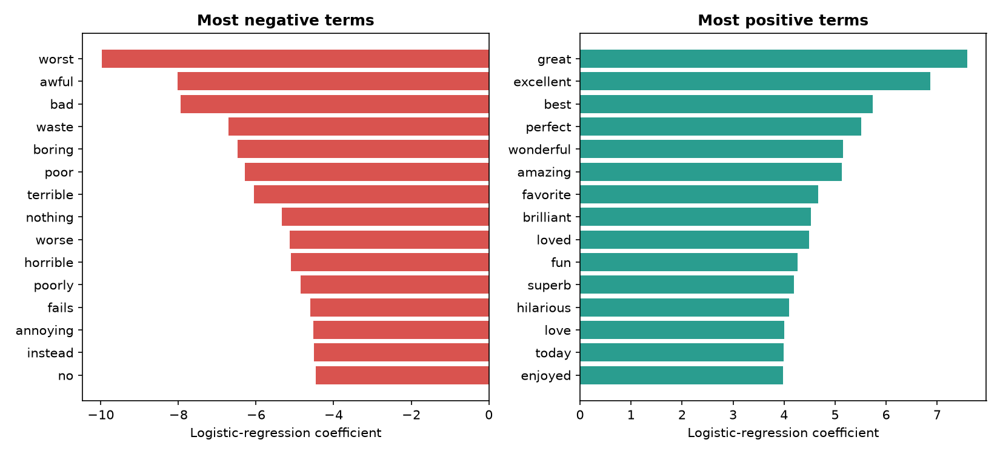

# 🎭 Movie Review Sentiment Analysis

[](https://www.python.org/)
[](https://scikit-learn.org/)
[](LICENSE)

**Author:** V. Sri Ram Reddy · **Type:** NLP / Machine Learning · **Stack:** scikit-learn, Flask, vanilla JS

An end-to-end sentiment classifier: **data → TF-IDF → logistic regression → evaluation → web app + API**.
Paste a movie review and it tells you whether it is positive or negative **and which words drove the decision**.

**Live demo:** https://reddy7996.github.io/sentiment-analysis/ (runs fully in your browser)

---

## Results (honest numbers)

All numbers come from `model/metrics.json`, produced by `python train.py`.

<!-- RESULTS:START -->
| Test set | Accuracy | Precision | Recall | F1 | Size |
|---|---|---|---|---|---|
| **IMDB reviews (held-out 20%)** | 90.0% | 0.89 | 0.91 | 0.90 | 9917 |
| Hand-written, natural reviews (never trained on) | 96.7% | 0.94 | 1.00 | 0.97 | 30 |

**How to read this**

- Trained on **49,582 real IMDB movie reviews** plus a small set of hand-written ones.
- The IMDB number (90.0%) is measured on 9,917 reviews the model never saw, so it is a trustworthy estimate.
- The 30 hand-written reviews are a second, tiny check (96.7%); treat it as rough.
<!-- RESULTS:END -->

Most informative words learned (from the model):
positive: *brilliant, wonderful, perfection, fantastic, splendid* · negative: *terrible, forgettable, awful, bad, tedious*



---

## Quick start

```bash
git clone https://github.com/Reddy7996/sentiment-analysis.git
cd sentiment-analysis
pip install -r requirements.txt

python train.py                 # trains, evaluates, saves model/ + docs/model.json + charts
python app.py                   # web app at http://localhost:5000
python sentiment.py "Not bad at all, quite good!"   # command line
python -m pytest -q tests       # tests
```

API:

```bash
curl -X POST localhost:5000/api/predict -H "Content-Type: application/json" \
     -d '{"review": "A brilliant, moving film."}'
# {"label":"positive","confidence":0.868,"prob_positive":0.868,"top_words":[{"word":"brilliant","weight":1.5016},...],"known_words":2}
```

Notebook walkthrough: [`sentiment_analysis.ipynb`](sentiment_analysis.ipynb).

## Deploy

| Option | Steps |
|---|---|
| **GitHub Pages** (static, free, no server) | Push to GitHub → repo *Settings → Pages → Deploy from a branch → `main` / `/docs`*. The model runs in the browser from `docs/model.json`. |
| **Render** (Flask API + UI) | New → *Blueprint* → pick this repo (`render.yaml` is included). |
| **Docker** (anywhere) | `docker build -t sentiment . && docker run -p 8000:8000 sentiment` |
| **Heroku-style** | `Procfile` is included (`gunicorn app:app`). |

## Project layout

```
train.py                    training + evaluation + export
sentiment.py                load model, predict with explanations
app.py                      Flask UI + /api/predict + /health
docs/                       static demo (index.html) + exported model.json / metrics.json
data/reviews.csv            5,000 template-generated reviews
data/handwritten_reviews.csv 90 natural reviews (60 train / 30 held-out test)
generate_sample_data.py     regenerates data/reviews.csv
sentiment_analysis.ipynb    step-by-step notebook
tests/                      unit + API tests, and a check that the browser model == Python model
```

---

## How it works (plain English)

Think of a robot learning to tell happy reviews from angry ones.

1. **Turn words into numbers (TF-IDF).** A word counts for more when it is frequent in *this* review but rare overall. "Brilliant" is informative; "film" is not. We use single words *and* word pairs ("not good", "waste time"), and we drop filler words (*the, is, a*) **but keep negations** (*not, no, never*), because "not good" means the opposite of "good".
2. **Learn the weights (logistic regression).** Training gives every word a score: positive for words that appear in happy reviews, negative for the others. A review's final score is the sum of its words' scores, squashed into a 0–100% probability.
3. **Test on reviews the model has never seen.** This is the only honest way to measure it. The 30 hand-written test reviews are never used for training or tuning.
4. **Tune carefully.** The template data is too easy to tell good settings from bad ones, so the regularisation strength `C` and the weight given to the hand-written training reviews are chosen by 5-fold cross-validation on the hand-written training reviews only.
5. **Explain.** For each prediction the app shows the words with the largest contribution (`tf-idf × coefficient`).

The browser demo re-implements steps 1–2 in about 20 lines of JavaScript from the exported `docs/model.json`; a test confirms it gives the same probabilities as the Python model.

## Limitations & next steps

- [ ] Train on a real, large dataset (IMDB) and report that number here
- [ ] Sarcasm, mixed reviews and long context are beyond bag-of-words; try DistilBERT
- [ ] Multi-class (1–5 stars) and aspect-based sentiment (acting, plot, effects)
- [ ] Grow the hand-written test set (30 reviews is a wide error bar)

## Contact

**V. Sri Ram Reddy** · vemireddysriramreddy2141@gmail.com ·
[LinkedIn](https://linkedin.com/in/sriramreddy-vemireddy-217839275)

## License

MIT, see [LICENSE](LICENSE).
